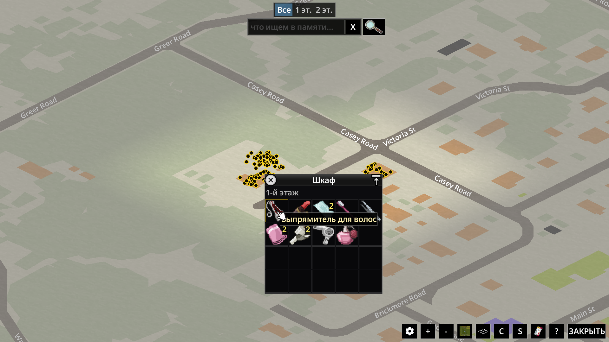
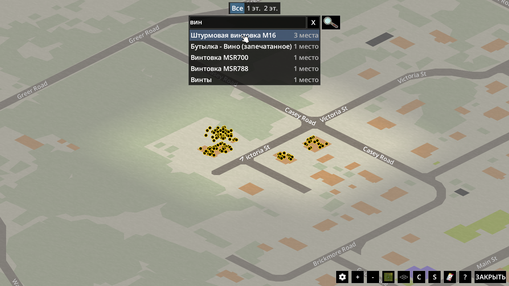
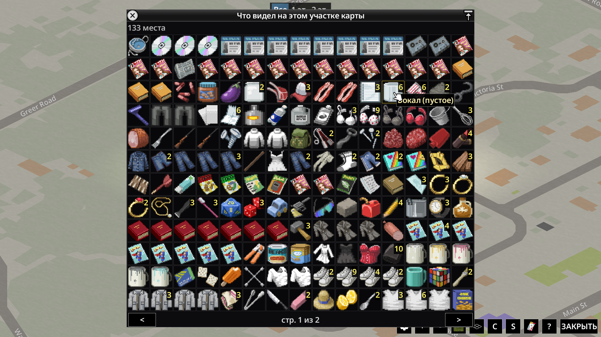
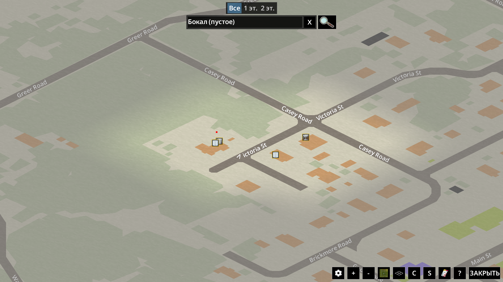

**English** · [Русский](README.ru.md)

# Loot Memory Map

A Project Zomboid mod that remembers where you saw items with your own eyes
and shows them on the world map. With one button it also gathers everything
you have seen in the part of the map on screen into a single window — to
quickly find what you need, for example in a pile of corpses after a big horde.

## Features

- **Marks on the map.** A cupboard you opened, items on the floor you noticed,
  a corpse you stood next to — they all appear on the world map as marks. Hover
  to see what is there and on which floor; click to open a window with the
  item icons.

  
- **Only what you saw.** A closed cupboard in the next room or an upper floor
  you never climbed to will not show up.
- **Search.** Start typing a name in the box above the map — a list of what you
  have seen drops down, with the number of places. Pick an item to keep only
  the places that have it.

  
- **Everything on screen.** The magnifier button next to the search box opens a
  window with every item you have seen in the part of the map currently on
  screen, with identical items stacked into one cell with a total count. Click
  an item to keep only the places where it lies — handy for finding loot in a
  pile of corpses after a big horde.

  

  
- **Floors.** When the screen shows places on several floors, a level switch
  appears above the search box: basement, 1st floor, 2nd…
- **Memory checks itself.** When you see a place again, items you took and
  corpses that are gone disappear from the map.

## Languages

English, Russian.

## Installation

1. Click the green **Code** button at the top of this page → **Download ZIP**.
2. Unpack `LootMemoryMap-main.zip`. Inside is a folder `LootMemoryMap-main`,
   and in it the **`LootMemoryMap`** folder.
3. Put the `LootMemoryMap` folder into the game's `mods` folder:
   - Windows: `C:\Users\<your name>\Zomboid\mods`
   - macOS: `/Users/<your name>/Zomboid/mods`
   - Linux: `/home/<your name>/Zomboid/mods`

   You should end up with `mods/LootMemoryMap/42/mod.info`. If there is no
   `mods` folder, start the game once — it creates the folder itself.

## Enabling

- **New game:** main menu → **MODS** → tick "Loot Memory Map" → go back and
  agree to save the changes.
- **Existing save:** main menu → **LOAD** → select the save → **MORE...** →
  **Choose Mods...** → tick "Loot Memory Map" → back → **PLAY**. The mod adds no
  items or maps, so adding it to a game in progress is safe. Memory starts
  building up from that moment.

## Settings

Options → Mods → "Loot Memory Map":

- show the layer on the map;
- remember what you saw from a distance — items on the floor, not only opened
  containers.

Records older than three in-game months are shown dimmed on the map.

## Limitations

- Build 42.21.
- Single player; multiplayer has not been tested.
- Car trunks and glove boxes are not remembered: the car drives away.
