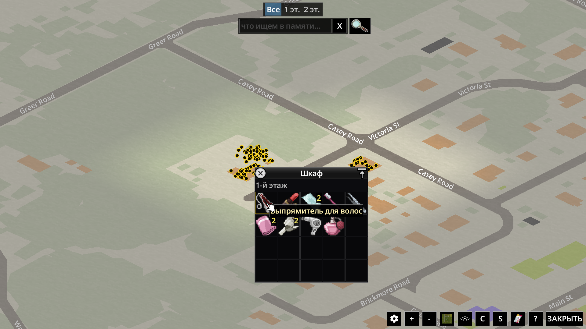
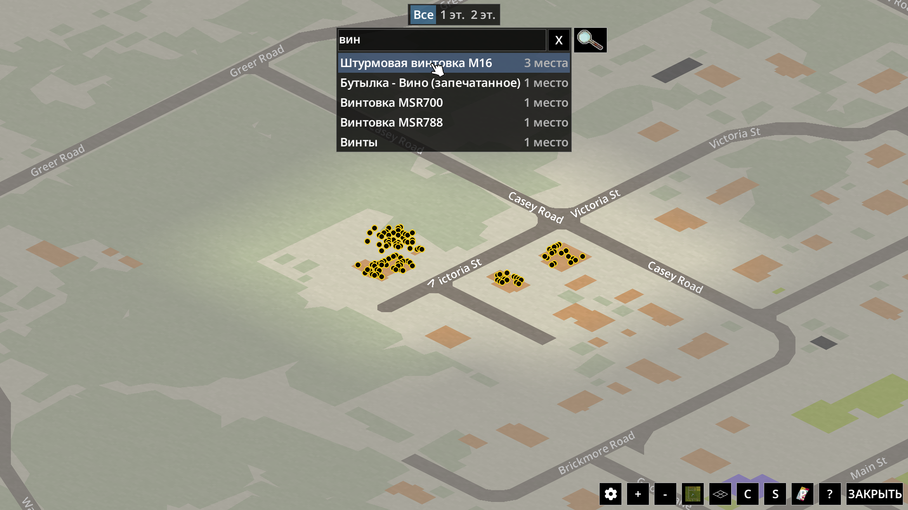
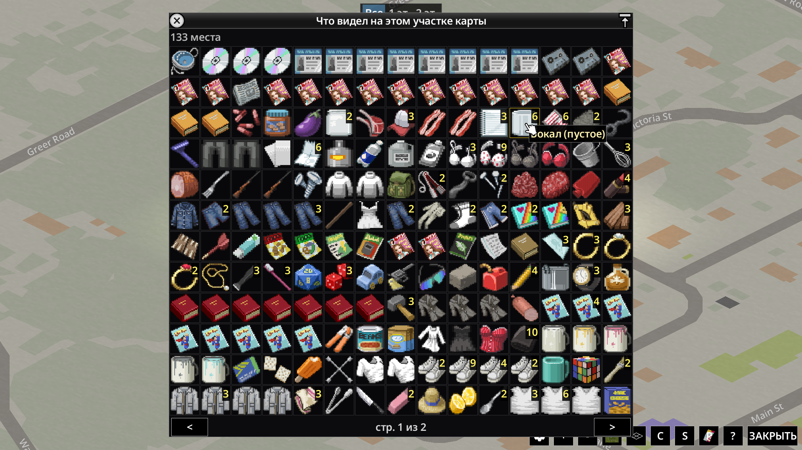
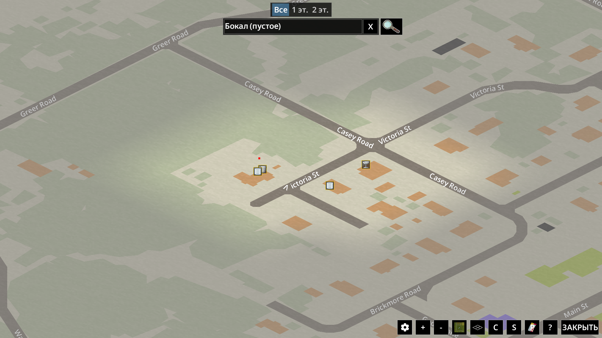

[English](README.md) · **Русский**

# Карта находок

Мод для Project Zomboid: помнит, где вы своими глазами видели предметы, и
показывает их на карте мира. А одной кнопкой собирает в окно всё, что вы
видели на видимом сейчас участке карты, — чтобы быстро найти нужное,
например в куче трупов после большой толпы.

## Что умеет

- **Метки на карте.** Шкаф, который вы открывали, вещи на полу, попавшиеся
  на глаза, труп, у которого вы стояли, — всё это появляется на карте мира
  метками. При наведении видно, что там лежит и на каком этаже, по щелчку
  открывается окно с иконками предметов.

  
- **Только увиденное.** Закрытый шкаф в соседней комнате или второй этаж, куда
  вы не поднимались, на карте не появятся.
- **Поиск.** Начните вводить название в строке над картой — выпадет список
  того, что вы видели, с числом мест. Выберите предмет — на карте останутся
  только места с ним.

  
- **Всё, что видно на экране.** Кнопка с лупой рядом со строкой поиска
  открывает окно со всеми предметами, которые вы видели на видимом сейчас
  участке карты: одинаковые сложены в одну ячейку с общим числом. Щёлкните по
  предмету — на карте останутся только места, где он лежит. Удобно, чтобы
  найти нужное в куче трупов после большой толпы.

  

  
- **Этажи.** Если на экране есть места на разных этажах, над поиском
  появляется переключатель: подвал, 1-й этаж, 2-й…
- **Память сверяется сама.** Когда вы снова видите место, забранные вещи и
  исчезнувшие трупы уходят с карты.

## Языки

Русский, Английский.

## Установка

1. Нажмите зелёную кнопку **Code** вверху страницы → **Download ZIP**.
2. Распакуйте архив `LootMemoryMap-main.zip`. Внутри — папка
   `LootMemoryMap-main`, а в ней папка **`LootMemoryMap`**.
3. Положите папку `LootMemoryMap` в папку `mods` игры:
   - Windows: `C:\Users\<ваше имя>\Zomboid\mods`
   - macOS: `/Users/<ваше имя>/Zomboid/mods`
   - Linux: `/home/<ваше имя>/Zomboid/mods`

   Должно получиться `mods/LootMemoryMap/42/mod.info`. Если папки `mods` нет,
   запустите игру один раз — она создаст её сама.

## Включение

- **Новая игра:** главное меню → **МОДЫ** → поставьте галочку у «Карта
  находок» → вернитесь назад и согласитесь сохранить изменения.
- **Уже начатая игра:** главное меню → **ЗАГРУЗИТЬ** → выберите сохранение →
  **ПОДРОБНЕЕ...** → **Выбрать моды...** → галочка у «Карта находок» → назад →
  **ИГРАТЬ**. Мод не добавляет ни предметов, ни карт, поэтому подключать его
  к начатой игре безопасно. Память начнёт копиться с этого момента.

## Настройки

Настройки → Моды → «Карта находок»:

- показывать слой на карте;
- запоминать увиденное глазами — вещи на полу, а не только открытые
  контейнеры.

Записи старше трёх игровых месяцев показываются на карте приглушённо.

## Ограничения

- Сборка 42.21.
- Одиночная игра; мультиплеер не проверялся.
- Содержимое багажников и бардачков машин не запоминается: машина уезжает.
